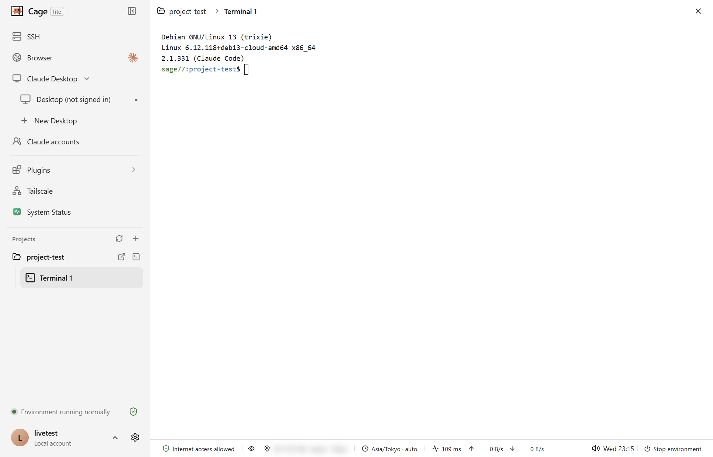
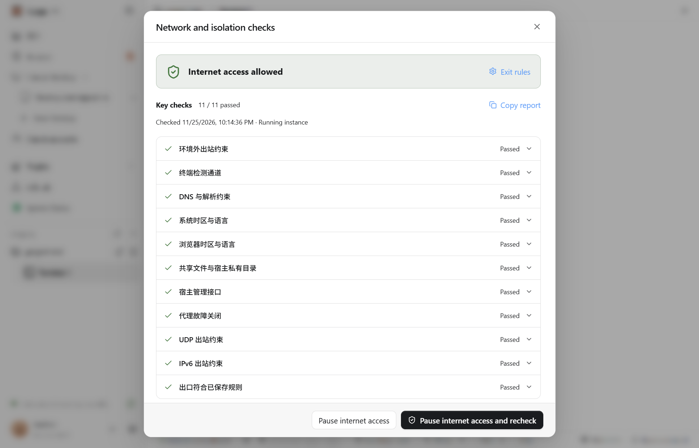
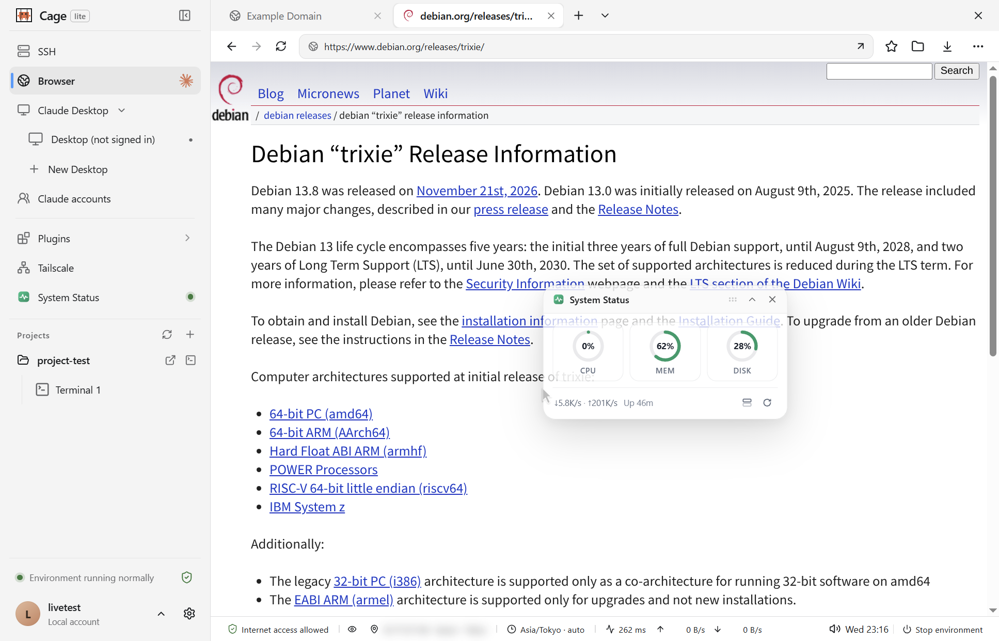
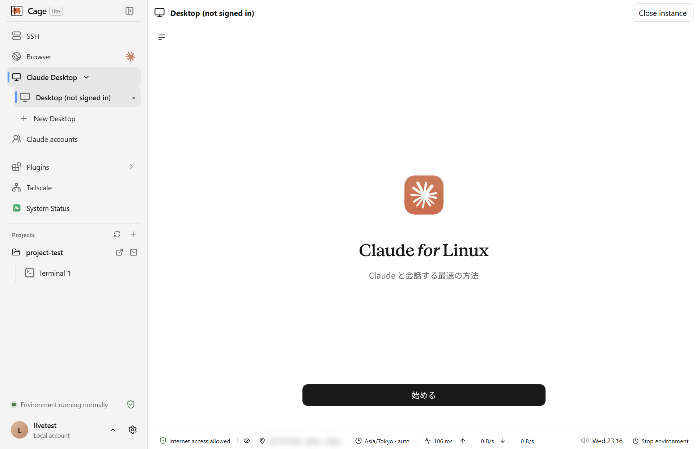

<div align="center">

<h1>Cage lite</h1>

An independent fork of [Claude Cage](https://github.com/Lee-xeo/Claude-Cage) · Windows


[](https://github.com/gege-tlph/Claude-Cage/releases) [](LICENSE)

**[Download](https://github.com/gege-tlph/Claude-Cage/releases) · [Upstream project](https://github.com/Lee-xeo/Claude-Cage) · [Documentation (upstream)](https://claude-cage.com/docs/)**

[简体中文](README.md) · English

</div>

## Cage lite

- Follows upstream Claude Cage, takes upstream fixes as needed, and develops its own main line.
- Windows only for now: Windows 10 22H2 or Windows 11, x64.
- The interface is maintained in Simplified Chinese and English only.
- In-app updates come from this repository's [Releases](https://github.com/gege-tlph/Claude-Cage/releases).

### Install

1. Download `Cage-X.Y.Z-windows-amd64-setup.exe` from [Releases](https://github.com/gege-tlph/Claude-Cage/releases).
2. Run the installer. On the options page, keep "Trust the Cage lite publisher certificate" checked (it is checked by default), and choose "Yes" when Windows asks for confirmation. If upstream Cage is already installed, install over it; the environment and data are kept.
3. Fallback: if you unchecked that option or used a silent install, import the root certificate `cage-lite-signing.cer` by hand. It is attached to every Release and lives in `packaging/windows/` in this repository.
   ```powershell
   Import-Certificate -FilePath .\cage-lite-signing.cer -CertStoreLocation Cert:\CurrentUser\Root
   ```
   Cage lite works without trusting this certificate, but Windows shows the publisher as unknown and in-app updates cannot install automatically.

## Screenshots

| Terminal and project | Network and isolation checks |
| :---: | :---: |
| <a href="assets/readme/workbench-en.png"></a> | <a href="assets/readme/network-checks-en.png"></a> |
| **Environment browser and floating plugin view** | **Claude Desktop** |
| <a href="assets/readme/browser-plugin-en.png"></a> | <a href="assets/readme/claude-desktop-en.png"></a> |

Screenshots from 0.2.2, with the exit IP blurred. The exit is in Tokyo and the environment language is set automatically to Japanese, so Desktop shows Japanese text. The check names in the network panel are not translated yet.

## Requirements

- x64 Windows 10 22H2, Windows 10 Enterprise / IoT Enterprise LTSC 2021, or Windows 11. Regular 21H2 with the same build number, ARM64 and 32-bit systems are not supported.
- CPU virtualization enabled in BIOS/UEFI, and the Windows Hypervisor Platform feature turned on. Hyper-V management tools, WSL and Docker are not needed.
- Local disk space: the environment's virtual disk starts with a 24 GiB limit.
- Your own proxy: a Clash/Mihomo subscription or configuration, or an HTTP/SOCKS5 node. Cage lite provides neither a proxy nor a Claude account.

## How it works

Cage lite runs a Debian 13 virtual machine (the "environment") in QEMU on Windows. Claude Code, Claude Desktop and the browser run inside the environment; the Windows side handles display, proxying and management.

| Layer | Component | Role |
|---|---|---|
| Window | `Cage.exe` (.NET 10 + WebView2, `desktop/windows`) | App window, tray, in-app updates |
| Workbench | `cage serve` (Go, `internal/workbench`) + React UI (`ui/`) | HTTP/WebSocket API on the loopback address only; terminals use xterm.js, browser and Desktop displays use noVNC |
| Virtual machine | Embedded Lima hostagent + QEMU (WHPX acceleration) | Starts and stops the environment, SSH channel, shared folders |
| Proxy | Mihomo, a separate process on Windows | Every outbound connection from the environment goes through it |
| Environment | Debian 13: Claude Code, Claude Desktop (Linux build), Chromium, code-server, plugin services | The browser and each Desktop instance get their own TigerVNC virtual display |

## Network model

- Public outbound traffic is IPv4 TCP only. Connections are handed to Mihomo at the virtual NIC on the Windows side; there is no direct fallback when the proxy is unavailable.
- DNS goes through the same proxy as DoH and never falls back to Windows DNS.
- Public UDP, IPv6, ICMP, and direct connections to Windows itself or the LAN are blocked. These limits are enforced outside the virtual machine; sudo inside the environment cannot turn them off.
- Internet gate: after the environment starts or the node changes, a round of network and isolation checks runs (outbound, DNS, UDP, IPv6, time zone and language, shared folders, management API, proxy-failure shutdown, exit rules: 11 in total). Internet access opens only when all pass, and stays closed while checking and on failure. Third-party IP reputation is reference only and does not affect the decision.
- When the proxy core exits or stops responding, the current node is re-applied automatically, and internet access resumes only after a full check passes.
- Optional "Direct LAN" (Settings → Network and proxy): enter a range inside 10.0.0.0/8, 172.16.0.0/12 or 192.168.0.0/16, and while internet access is allowed the environment can reach devices there over TCP without the proxy. Windows' own addresses are never opened, and Direct LAN closes together with internet access.
- Optional Tailscale: sign in inside the environment to reach devices according to your tailnet permissions; the outer traffic still goes through the proxy.

## Data and permission boundaries

- Only the default workspace, explicitly opened project folders and the download staging folder are shared. Changing or deleting shared files inside the environment changes the original files on Windows, including Git operations.
- All projects share one environment; projects are not isolated from each other.
- Proxy credentials stay in Windows' private configuration and are not passed into the environment. Claude sign-ins, browser profiles and SSH keys on Windows are not imported.
- SSH for workbench terminals disables the escape character, local commands, ProxyCommand/ProxyJump, agent and X11 forwarding, and password sign-in.
- The workbench API listens on the loopback address only and checks Host, Origin and the session, so web pages cannot call management operations directly.
- Configuration, proxy and environment data live in `%USERPROFILE%\.claude-cage` by default and are kept when the app is uninstalled.
- Virtual machine or browser vulnerabilities, an administrator changing settings on Windows, and running a shared project's scripts on Windows are outside what this isolation can prevent.

## Plugins

Plugin = MCP tools + workbench pages. The plugin market is upstream's [cage-plugins](https://github.com/Lee-xeo/cage-plugins).

- Plugins run inside the environment as a regular user by default. "Host tools" that use Windows capabilities must be turned on separately, run with the permissions the plugin declares, and ask for confirmation before each call by default.
- A page can be a full page in the sidebar or a draggable, collapsible floating window (`presentation: "floating"` in the plugin manifest).
- Development guide: [docs/plugins.md](docs/plugins.md) (Chinese).

## For local agents

`cage agent` calls workbench operations with JSON input and output, such as starting and stopping the environment, importing a proxy, or updating environment components. Run `cage agent capabilities` to list what is supported; see [AGENT-USE.md](AGENT-USE.md) and [docs/guide/agent.md](docs/guide/agent.md).

## Code layout

| Directory | Contents |
|---|---|
| `cmd/cage` | CLI and background entry points (`cage serve`, `cage agent`, `cage run`, …) |
| `internal/workbench` | Workbench API: environment, terminals, browser, Desktop, accounts, plugins, settings |
| `internal/cage` | Environment lifecycle, guest setup scripts, internet gate |
| `internal/managedproxy` | Mihomo configuration, subscriptions and nodes, outbound NIC selection |
| `internal/netguard` | Decides which network addresses the environment may reach |
| `third_party/lima` | Embedded Lima |
| `ui` | Workbench UI (React + Vite) |
| `desktop/windows` | Windows shell (WebView2) and tray |
| `packaging/windows` | NSIS installer and signing certificate |
| `tools/tailnet` | Tailscale component inside the environment |
| `mobile` | Android / iOS clients |
| `docs` | User documentation, mostly from upstream and in Chinese; the macOS and Linux parts do not apply to Cage lite. `docs/releases` holds Cage lite's release notes |

## Build from source

Run on Windows x64 with PowerShell 7. You need Go (version in `go.mod`), .NET SDK 10.0.404 (`global.json`), Node.js 24, uv, full 7-Zip and the WebView2 runtime; building QEMU needs MSYS2 UCRT64, and the installer needs NSIS. Full tool list and troubleshooting: [docs/windows.md](docs/windows.md#windows-源码构建) (Chinese).

```powershell
$env:CAGE_MSYS2_ROOT = 'C:\msys64'
.\scripts\build-windows.ps1                 # app in _output\windows-amd64\app
.\scripts\package-windows.ps1 -SkipBuild    # installer in _output\releases\<version>\windows
```

## Tests

```powershell
go test ./...
npm test --prefix ui
npm run lint --prefix ui
```

Some Go tests need Linux or a real environment and do not pass on Windows. The tests the release workflow runs on Windows are listed in `scripts/ci-windows-build.ps1`.

## Releases and verification

- Releases are started by hand on main with the GitHub Actions workflow `cage-lite-release.yml`: signed build → draft → download again and compare hashes → publish.
- Every Release includes `SHA256SUMS`, the signing certificate `cage-lite-signing.cer`, and the corresponding sources of Mihomo (GPL-3.0) and QEMU (GPL-2.0) shipped in the installer.
- In-app updates come only from this repository's Releases.
- Changes per version: [docs/releases](docs/releases) (Chinese).

## Origin and license

Cage lite is a fork of [Claude Cage](https://github.com/Lee-xeo/Claude-Cage), which is built on [agent-vm](https://github.com/sylvinus/agent-vm).

The main license is [MIT](LICENSE). Bundled components keep their own licenses; Mihomo is distributed as a separate executable under GPL-3.0. See also [NOTICE](NOTICE), [third-party licenses](THIRD_PARTY_LICENSES) and [noVNC](ui/vendor/novnc/LICENSE.txt).

Cage lite is an independent community project and is not affiliated with Anthropic.

## Acknowledgments

- [Claude Cage](https://github.com/Lee-xeo/Claude-Cage): the upstream project.
- [agent-vm](https://github.com/sylvinus/agent-vm): the base Cage is built on.
- [Lima](https://github.com/lima-vm/lima): virtual machine management and the Linux environment runtime.
- [gvisor-tap-vsock](https://github.com/containers/gvisor-tap-vsock): virtual machine networking.
- [sshocker](https://github.com/lima-vm/sshocker) and [SFTP](https://github.com/pkg/sftp): file sharing between the virtual machine and the host.
- [noVNC](https://github.com/novnc/noVNC): remote display and interaction in the browser.
- [Mihomo](https://github.com/MetaCubeX/mihomo): the built-in proxy core.
- [code-server](https://github.com/coder/code-server): the code editor in the browser.
- [AIO Sandbox](https://github.com/agent-infra/sandbox): reference for the work environment and interaction design.
- [claude-switcher](https://github.com/YOURSJEYO/claude-switcher) and [Claude-Guardian](https://github.com/DUNHKpcc/Claude-Guardian): reference for network checks and security diagnostics.
- [claude-post-ban-cleanup](https://github.com/l2461090/claude-post-ban-cleanup): reference for precise inventory, protecting user data and recoverable cache cleanup; Cage implements it independently.
