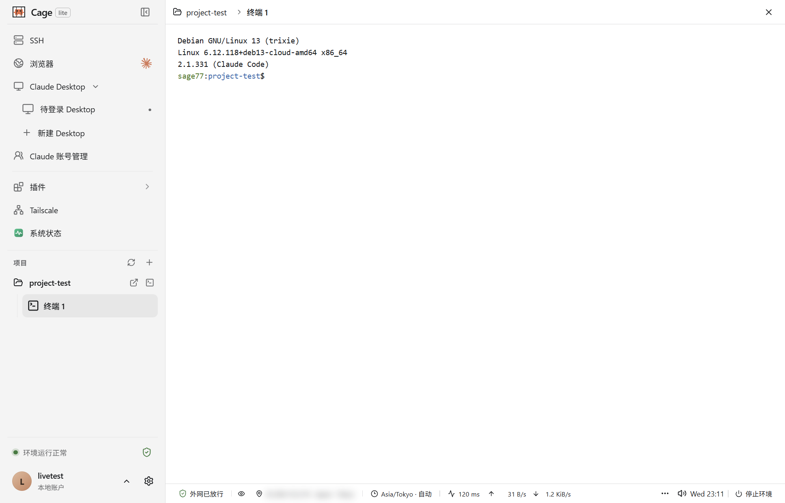
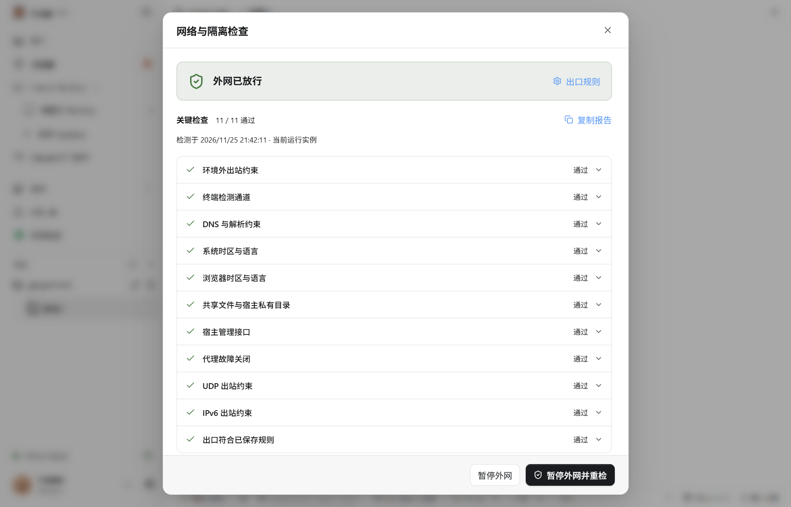
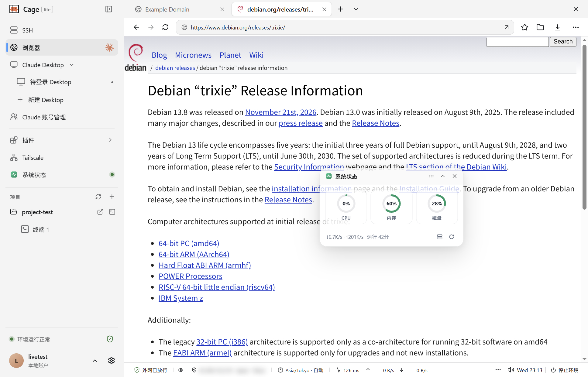
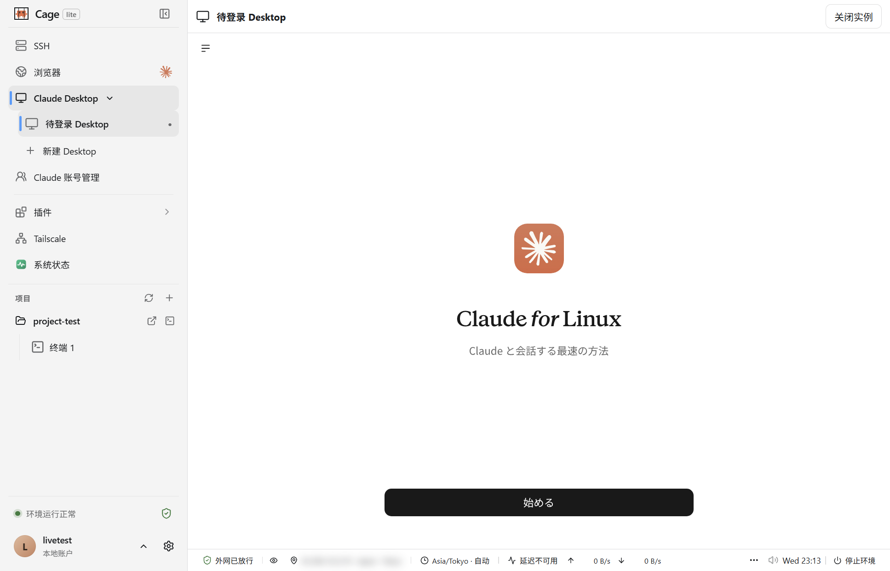

<div align="center">

<h1>Cage lite</h1>

基于 [Claude Cage](https://github.com/Lee-xeo/Claude-Cage) 的独立分支 · Windows


[](https://github.com/gege-tlph/Claude-Cage/releases) [](LICENSE)

**[下载](https://github.com/gege-tlph/Claude-Cage/releases) · [上游项目](https://github.com/Lee-xeo/Claude-Cage) · [使用文档（上游）](https://claude-cage.com/docs/)**

</div>

## Cage lite

- 跟随上游 Claude Cage，按需合入上游的修复，主线独立开发。
- 目前只发布 Windows 版：Windows 10 22H2 或 Windows 11，x64。
- 界面只维护简体中文和英文。
- 应用内更新从本仓库的 [Releases](https://github.com/gege-tlph/Claude-Cage/releases) 获取。

### 安装

1. 从 [Releases](https://github.com/gege-tlph/Claude-Cage/releases) 下载 `Cage-X.Y.Z-windows-amd64-setup.exe`。
2. 运行安装包。在安装选项页勾选“信任 Cage lite 发布者证书”（默认已勾选），Windows 弹出确认时选“是”。已经装了上游 Cage 的，直接覆盖安装，环境和数据都会保留。
3. 备用：如果安装时没有勾选这一项，或者用的是静默安装，可以手动导入根证书 `cage-lite-signing.cer`。它附在每个 Release 里，仓库中的位置是 `packaging/windows/`。
   ```powershell
   Import-Certificate -FilePath .\cage-lite-signing.cer -CertStoreLocation Cert:\CurrentUser\Root
   ```
   不信任这个证书也能使用，但 Windows 会显示发布者未知，应用内更新也不能自动安装。

English: [README.en.md](README.en.md)

## 截图

| 终端与项目 | 网络与隔离检查 |
| :---: | :---: |
| <a href="assets/readme/workbench-zh.png"></a> | <a href="assets/readme/network-checks-zh.png"></a> |
| **环境浏览器与插件浮窗** | **Claude Desktop** |
| <a href="assets/readme/browser-plugin-zh.png"></a> | <a href="assets/readme/claude-desktop-zh.png"></a> |

截图来自 0.2.2，出口 IP 已打码。出口在东京，环境语言自动设为日语，所以 Desktop 显示日文。

## 运行要求

- x64 的 Windows 10 22H2、Windows 10 企业版 / IoT 企业版 LTSC 2021，或 Windows 11。同版本号的普通 21H2、ARM64 和 32 位系统不支持。
- BIOS/UEFI 开启 CPU 虚拟化，Windows 开启“Windows 虚拟机监控程序平台”（Windows Hypervisor Platform）。不需要 Hyper-V 管理工具、WSL 或 Docker。
- 本地磁盘空间：环境的虚拟磁盘初始上限 24 GiB。
- 自己的代理：Clash/Mihomo 订阅或配置，或 HTTP/SOCKS5 节点。Cage lite 不提供代理和 Claude 账号。

## 工作原理

Cage lite 在 Windows 上用 QEMU 运行一台 Debian 13 虚拟机（下称“环境”）。Claude Code、Claude Desktop 和浏览器都在环境里运行，Windows 这边负责显示、代理和管理。

| 层 | 组件 | 作用 |
|---|---|---|
| 窗口 | `Cage.exe`（.NET 10 + WebView2，`desktop/windows`） | 应用窗口、托盘、应用内更新 |
| 工作台 | `cage serve`（Go，`internal/workbench`）+ React 界面（`ui/`） | 只监听本机回环地址的 HTTP/WebSocket 接口；终端用 xterm.js，浏览器和 Desktop 的画面用 noVNC |
| 虚拟机 | 内置的 Lima hostagent + QEMU（WHPX 加速） | 环境的启停、SSH 通道和共享目录 |
| 代理 | Mihomo，Windows 上的独立进程 | 环境的所有对外连接都经它出去 |
| 环境 | Debian 13：Claude Code、Claude Desktop（Linux 版）、Chromium、code-server、插件服务 | 浏览器和每个 Desktop 实例各用一块独立的 TigerVNC 虚拟显示 |

## 网络模型

- 公网出站只有 IPv4 TCP。连接在 Windows 侧的虚拟网卡出口交给 Mihomo，代理不可用时没有直连回退。
- DNS 经同一代理转为 DoH，不回退到 Windows 的 DNS。
- 公网 UDP、IPv6、ICMP，以及到 Windows 本机和局域网的直连都被拦下。这些限制在虚拟机外执行，环境里的 sudo 关不掉。
- 外网闸门：环境启动或换节点后，先跑一轮网络与隔离检查（出站、DNS、UDP、IPv6、时区与语言、共享目录、管理接口、代理故障关闭、出口规则等 11 项），全部通过才放行；检查期间和失败时外网保持关闭。第三方 IP 信誉只作参考，不参与判定。
- 代理核心退出或不再响应时，自动重新应用当前节点，完整检查通过后才恢复外网。
- 可选“局域网直连”（设置 → 网络与代理）：填一个 10.0.0.0/8、172.16.0.0/12 或 192.168.0.0/16 内的网段，外网放行期间环境可以用 TCP 直连其中的设备，不经代理。Windows 本机地址始终不开放，外网关闭时它也一起关闭。
- 可选 Tailscale：在环境里登录后按私网权限连接设备，外层通信仍走代理。

## 数据与权限边界

- 只共享默认工作区、明确打开的项目文件夹和下载暂存目录。在环境里修改或删除共享文件，会直接改动 Windows 上的原文件，包括 Git 操作。
- 所有项目共用同一个环境，项目之间没有隔离。
- 代理凭据留在 Windows 的私有配置里，不传进环境。Windows 上的 Claude 登录、浏览器配置和 SSH 密钥不会导入环境。
- 工作台终端的 SSH 禁用转义字符、本机命令、ProxyCommand/ProxyJump、代理与 X11 转发和密码登录。
- 工作台接口只监听本机回环地址，并校验 Host、Origin 和会话，网页不能直接调用管理操作。
- 配置、代理和环境数据默认在 `%USERPROFILE%\.claude-cage`，卸载应用不会删除。
- 虚拟机或浏览器漏洞、Windows 管理员改配置、在 Windows 上运行共享项目里的脚本，都超出这层隔离能防的范围。

## 插件

插件 = MCP 工具 + 工作台页面，插件市场是上游的 [cage-plugins](https://github.com/Lee-xeo/cage-plugins)。

- 插件默认在环境里以普通用户身份运行。要调用 Windows 本机能力的“主机工具”需要单独开启，按插件声明的权限运行，默认每次调用前确认。
- 页面可以是侧栏里的整页，也可以是可拖动、可收起的浮窗（插件清单里 `presentation: "floating"`）。
- 开发规范见 [docs/plugins.md](docs/plugins.md)。

## 给本机 Agent 用

`cage agent` 以 JSON 输入输出调用工作台操作，比如启停环境、导入代理、更新环境组件。用 `cage agent capabilities` 查看支持的操作，说明见 [AGENT-USE.md](AGENT-USE.md) 和 [docs/guide/agent.md](docs/guide/agent.md)。

## 代码结构

| 目录 | 内容 |
|---|---|
| `cmd/cage` | 命令行与后台入口（`cage serve`、`cage agent`、`cage run` 等） |
| `internal/workbench` | 工作台接口：环境、终端、浏览器、Desktop、账号、插件、设置 |
| `internal/cage` | 环境生命周期、客机配置脚本、外网闸门 |
| `internal/managedproxy` | Mihomo 配置、订阅与节点、出口网卡选择 |
| `internal/netguard` | 环境可以访问哪些网络地址的判定 |
| `third_party/lima` | 内置的 Lima |
| `ui` | 工作台界面（React + Vite） |
| `desktop/windows` | Windows 外壳（WebView2）与托盘 |
| `packaging/windows` | NSIS 安装包和签名证书 |
| `tools/tailnet` | 环境里的 Tailscale 组件 |
| `mobile` | Android / iOS 客户端 |
| `docs` | 使用文档，大部分沿用上游，其中 macOS 和 Linux 的内容不适用于 Cage lite；`docs/releases` 是 Cage lite 的发行说明 |

## 从源码构建

在 Windows x64 上用 PowerShell 7 运行。需要 Go（版本见 `go.mod`）、.NET SDK 10.0.404（见 `global.json`）、Node.js 24、uv、完整版 7-Zip 和 WebView2 运行时；编译 QEMU 需要 MSYS2 UCRT64，生成安装包需要 NSIS。工具清单和常见问题见 [docs/windows.md](docs/windows.md#windows-源码构建)。

```powershell
$env:CAGE_MSYS2_ROOT = 'C:\msys64'
.\scripts\build-windows.ps1                 # 应用输出到 _output\windows-amd64\app
.\scripts\package-windows.ps1 -SkipBuild    # 安装包输出到 _output\releases\<版本>\windows
```

## 测试

```powershell
go test ./...
npm test --prefix ui
npm run lint --prefix ui
```

一部分 Go 测试需要 Linux 或真实环境，在 Windows 上本来就不通过。发布流程在 Windows 上跑的测试见 `scripts/ci-windows-build.ps1`。

## 发布与校验

- 发布由 GitHub Actions 的 `cage-lite-release.yml` 在 main 上手动触发：签名构建 → 草稿 → 重新下载并核对哈希 → 发布。
- 每个 Release 附 `SHA256SUMS`、签名证书 `cage-lite-signing.cer`，以及安装包里 Mihomo（GPL-3.0）和 QEMU（GPL-2.0）的对应源码。
- 应用内更新只从本仓库的 Releases 获取。
- 各版本的改动见 [docs/releases](docs/releases)。

## 来源与许可

Cage lite 是 [Claude Cage](https://github.com/Lee-xeo/Claude-Cage) 的分支，Claude Cage 基于 [agent-vm](https://github.com/sylvinus/agent-vm) 二次开发。

主许可为 [MIT](LICENSE)。随附组件保留各自的许可，Mihomo 作为独立可执行文件按 GPL-3.0 分发；另见 [NOTICE](NOTICE)、[第三方许可](THIRD_PARTY_LICENSES)、[noVNC](ui/vendor/novnc/LICENSE.txt)。

Cage lite 是独立社区项目，与 Anthropic 无隶属关系。

## 致谢

- [Claude Cage](https://github.com/Lee-xeo/Claude-Cage)：上游项目。
- [agent-vm](https://github.com/sylvinus/agent-vm)：Cage 的二次开发底座。
- [Lima](https://github.com/lima-vm/lima)：虚拟机管理与 Linux 环境的运行基础。
- [gvisor-tap-vsock](https://github.com/containers/gvisor-tap-vsock)：虚拟机网络。
- [sshocker](https://github.com/lima-vm/sshocker) 和 [SFTP](https://github.com/pkg/sftp)：虚拟机与主机之间的文件共享。
- [noVNC](https://github.com/novnc/noVNC)：浏览器中的远程画面与交互。
- [Mihomo](https://github.com/MetaCubeX/mihomo)：内置代理核心。
- [code-server](https://github.com/coder/code-server)：浏览器中的代码编辑器。
- [AIO Sandbox](https://github.com/agent-infra/sandbox)：工作环境和交互体验参考。
- [claude-switcher](https://github.com/YOURSJEYO/claude-switcher) 和 [Claude-Guardian](https://github.com/DUNHKpcc/Claude-Guardian)：网络检查和安全诊断方法参考。
- [claude-post-ban-cleanup](https://github.com/l2461090/claude-post-ban-cleanup)：精确盘点、保护用户资料与可恢复缓存清理的流程参考；Cage 独立实现。
